<p align="center"></p>

# Substrate

**The living knowledge graph for go-to-market.** Salesforce is the system of record.
Clay is the system of action. Substrate is the system of truth: every company, person,
job and signal — resolved, bitemporal, provenance-backed, streamed to wherever revenue
teams and their agents work.

[](https://github.com/adventurewave-labs/substrate/actions/workflows/ci.yml)


> **Landing page:** https://adventurewave-labs.github.io/substrate/


## Documents

| Doc | What it is |
|---|---|
| [PRD — v0.2 (2026-11-12)](docs/PRD-living-gtm-graph-2026-11-12.md) | Master product requirements: thesis, market evidence, wedge (Champion Graph), ER architecture, competitive landscape, pricing, metrics, decisions |
| [PLAN — M0–M2 execution (2026-11-12)](docs/PLAN-substrate-m0-m2-execution-2026-11-12.md) | 9-week build spec for the Resolve layer: scope lock, topology, DDL intent, ER engine, sources, week-by-week gates, burn |
| [KIT — design-partner outreach (2026-11-12)](docs/KIT-substrate-partner-outreach-2026-11-12.md) | ICP, target-list construction, outreach sequences with copy, Audit landing copy, partner term sheet, onboarding + M0 kickoff checklists |

## Status

- **Shipped:** resolve layer (deterministic ER v0 + golden-set harness), source layer
  (careers / SEC / press crawlers, LLM extraction gateway, Coresignal + PDL adapters),
  signals lane (job-change detector, bounded-retry delivery, canary replay), scheduler,
  deploy pipeline — **live on Railway**, migrations 001–008 applied, live suite runnable
  on demand against a disposable Postgres (`scripts/live-verify.sh`, not wired into CI),
  canary detection recall **1.0**
- **Honest gaps:** identity resolution is deterministic rules (the LightGBM scorer lands
  once hand-labeled golden pairs exist — `decide_fn` is injectable), precision is not yet
  measured on partner data, Graph Audit landing page and auth/API surface are not built
- **Next:** M2 gate on real partner CRMs — resolution ≥80%, merge precision ≥99.5%,
  alert→meeting stories (see the [outreach kit](docs/KIT-substrate-partner-outreach-2026-11-12.md))

## Dev setup

```bash
python3 -m venv .venv && .venv/bin/pip install -e ".[dev]"
.venv/bin/ruff check src tests && .venv/bin/mypy src && .venv/bin/pytest -q
.venv/bin/substrate import-csv --tenant demo --contacts-file export.csv --report report.json --dry-run
```

Layout: `src/substrate/` core services (config · db + migration runner · reconciliation · importers · store) · `src/substrate/migrations/` numbered SQL (packaged data) · `terraform/` infra (applied from the remote plane only) · `docs/` PRD / PLAN / KIT.

## Working agreements

- Milestones are gated by measured acceptance, never calendar (see PRD §12).
- Identity decisions are deterministic/learned ER — LLMs extract, never decide identity.
- Every PR is reviewed by a second AI model family against [written invariants](AGENTS.md);
  the signals lane went through 12 review rounds, which caught a version-ordering bug that
  would have silently killed promotion detection.
- No secrets in code: provider keys arrive via environment; error reports carry exception
  types only, so webhook URLs can never leak into report files.
